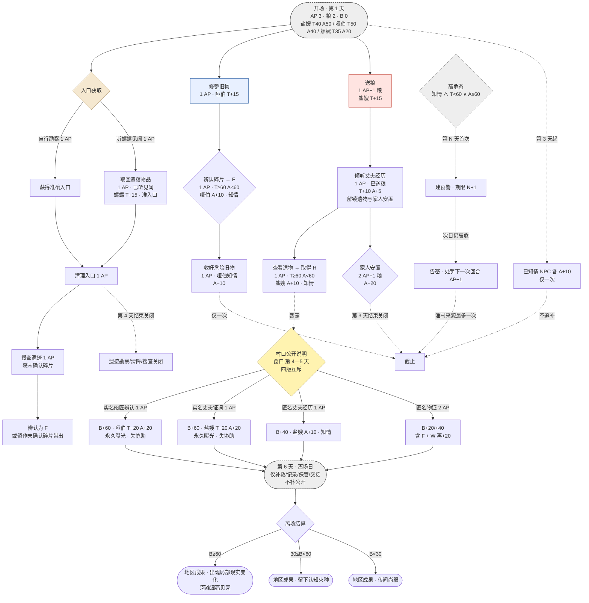

# 渔村六回合场景状态机

> 按 `docs/design/渔村六回合设定_v0.3.md` 第 2—6 节整理。
> 用途：看节奏与截止线；行动细节与 AP/条件见 v0.3 表格与 `tools/design/validate_village_v03.py`。

## 1. 主图（场景状态机）

## 2. 时间线（截止线速查）

| 截止 | 关闭内容 |
|---|---|
| 第 3 天结束 | 家人安置；公开窗口未开 |
| 第 3 天起（一次性） | 当时已知情 NPC 各 A+10 |
| 第 4 天结束 | 遗迹勘察/清障/搜查；水线观察 |
| 第 4—5 天 | 村口公开说明窗口（互斥一次） |
| 第 5 天公开后 → 第 6 天 | 实名对象收到问询；场景反馈展示 |
| 第 6 天 | 仅补救/记录/保管/交接；结束必须离场 |

## 3. 节点配色说明

- 红色 = 盐嫂线
- 蓝色 = 哑伯线
- 绿色 = 螺螺线
- 沙色 = 遗迹/入口线
- 黄色 = 公开说明（决策点）
- 灰虚线 = 截止线与全局机制

## 4. 这张图不画什么

- 行动细节（AP、精确前提、单独来源判定）见 v0.3 表格。
- 各路线的具体终局数值见 `docs/design/渔村六回合验证报告_v0.3.md`。
- 行动编排组合与平衡结论见 `tools/design/validate_village_v03.py`。
